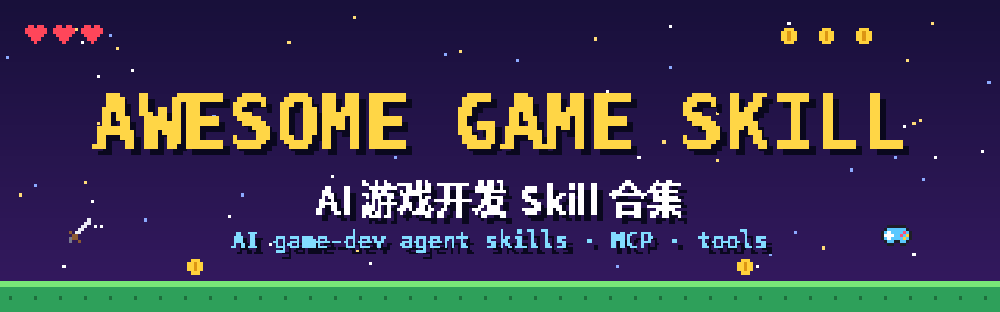
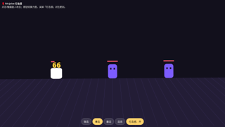
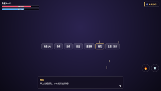

  

<h1 align="center">Awesome Game Skill</h1>

  <b>精选的 AI 游戏开发 Agent Skill、MCP 与工具合集</b> 
  <i>A curated list of AI game-dev agent skills, MCP servers and tools.</i>

  
  
  
  
  

- 🎮 **124 个条目**：能让 Claude Code、Codex、Cursor、Kimi 等 AI 编程 Agent 更会做游戏的 Skill（SKILL.md）、MCP 服务器和配套工具。
- 🕹️ **全引擎覆盖**：Unity / Unreal / Godot / Bevy / Roblox 等引擎，以及美术资产、像素风格、音效、测试与逆向。
- ✅ **链接都查过**：所有链接都经过可访问性检查，星数和许可证来自 GitHub API（2026-10-27 更新）。
- 🤖 **机器可读**：同一个仓库里的多个 skill 合并为一行，[`data/skills.json`](data/skills.json) 里保留了全部条目的明细。

- 姐妹仓库：[awesome-kimi-k3-game](https://github.com/gdfsdjj145/awesome-kimi-k3-game) — Kimi K3 做游戏的可玩效果与提示词
- 在线浏览：[gameskill.dev](https://gameskill.dev)
- 机器可读数据：[`data/skills.json`](data/skills.json)

> 🎮 **友情链接：[gameskill.dev](https://gameskill.dev)** — 我们的游戏 Skill 项目，在线浏览和搜索本列表。姐妹仓库：[awesome-kimi-k3-game](https://github.com/gdfsdjj145/awesome-kimi-k3-game)。

## 目录 / Contents

- [gameskill.dev 官方技能包 / gameskill.dev Packs](#gameskilldev-官方技能包--gameskilldev-packs)（4）
- [合集与插件 / Collections & Plugins](#合集与插件--collections--plugins)（27）
- [通用系统 / 路由 / General & Routing](#通用系统--路由--general--routing)（6）
- [游戏设计与玩法 / Game Design & Gameplay](#游戏设计与玩法--game-design--gameplay)（2）
- [Unity / Unity](#unity--unity)（5）
- [Unreal / Unreal](#unreal--unreal)（3）
- [Godot / Godot](#godot--godot)（6）
- [Roblox / Roblox](#roblox--roblox)（5）
- [其他引擎与 Web / Other Engines & Web](#其他引擎与-web--other-engines--web)（13）
- [美术资产与角色 / Art Assets & Characters](#美术资产与角色--art-assets--characters)（46）
- [美术风格与像素 / Art Styles & Pixel Art](#美术风格与像素--art-styles--pixel-art)（5）
- [音效 / Audio](#音效--audio)（2）
- [测试、逆向与发布 / Testing, RE & Release](#测试逆向与发布--testing-re--release)（4）
- [友情链接 / Friends](#友情链接--friends)
- [贡献指南 / Contributing](#贡献指南--contributing)
- [许可证 / License](#许可证--license)

## gameskill.dev 官方技能包 / gameskill.dev Packs

[gameskill.dev](https://gameskill.dev) 自己做的游戏 Skill 包，每个都带可运行示例和测试。免费包（MIT）不用登录就能下载；Pro 包随 [gameskill.dev Pro](https://gameskill.dev) 解锁。

| 名称 | 说明 | 档位 |
|---|---|---|
| [打击感 Hit Juice](https://gameskill.dev/pro/hit-juice) | 给 2D 网页游戏加打击感：创伤值震屏、命中停顿、闪白、挤压拉伸、击退、火花、伤害飘字和手机震动 | 免费 / Free |
| [转场 Screen Transition Kit](https://gameskill.dev/pro/screen-transition-kit) | 网页游戏场景转场：淡入淡出、圆形收缩、菱形、像素块、百叶窗、斜切、幕布，支持 await | 免费 / Free |
| [游戏 UI Game UI Kit](https://gameskill.dev/pro/game-ui-kit) | 常用游戏 UI：带残血延迟的血条、技能冷却按钮、打字机对话框、通知、连击、魔法阵和烟花，三套主题 | 免费 / Free |
| [抽卡 Gacha Kit](https://gameskill.dev/pro/gacha-kit) | 单抽、十连、SSR 开包、翻卡和全息卡，按稀有度分级演出 | Pro |

  
  
  

## 合集与插件 / Collections & Plugins

| 名称 | 说明 | ★ | 许可证 |
|---|---|---|---|
| [Claude-Code-Game-Studios](https://github.com/Donchitos/Claude-Code-Game-Studios) | 把 Claude Code 变成完整游戏工作室：49 个 agent、72 个工作流 skill，模拟真实团队协作。收录 `art-bible`、`balance-check`、`brainstorm`、`launch-checklist`、`localize`、`map-systems` 等 12 个 | 27,558 | MIT |
| [universal-modder](https://github.com/rehan-remade/universal-modder) | 让 Claude Code 给几乎任何自有 PC 游戏做 mod：侦察、逆向、资产生成（fal MCP）。收录 `fal-assets`、`asset-pipeline`、`mod-any-game` | 8,962 | MIT |
| [awesome-gamedev-agent-skills](https://github.com/gamedev-skills/awesome-gamedev-agent-skills) | 给 AI 编程 agent 的 74 个游戏开发 skill，覆盖 Godot、Unity、Unreal、Phaser、PixiJS、three.js、Bevy、pygame、LÖVE、Roblox，通用 SKILL.md 格式。收录 `router`、`ai-behavior-trees-utility-ai`、`audio-design`、`camera-systems`、`create-game-assets`、`dialogue-systems` 等 45 个 | 4,334 | Apache-2.0 |
| [sprite-gen](https://github.com/aldegad/sprite-gen) | 生成干净的 2D 游戏 sprite 和动画图集：分行生成、去底、切帧、运行时导出 | 3,037 | Apache-2.0 |
| [unreal-engine-skills-for-claude-code-plugin](https://github.com/EpicGames/unreal-engine-skills-for-claude-code-plugin) | Epic 官方的 Unreal Engine Claude Code 插件，含 Unreal MCP 和工具集 skill。收录 `create-toolset`、`unreal-mcp`、`unreal-skill` | 1,667 | MIT |
| [skills](https://github.com/Unity-Technologies/skills) | Unity 官方的 agent 可复用 skill 合集：面向 Unity 工作流的提示词、斜杠命令和工具。收录 `2d-pixel-perfect`、`asset-transformer-toolkit`、`audio-setup-mixers`、`build-gtk`、`build-live-game`、`create-2d-physics` 等 20 个 | 1,148 | 未声明（根目录无 LICENSE） |
| [skills](https://github.com/scenario-labs/skills) | 让任意 agent 产出可用的图片、视频、音频和 3D：自动选模型、先报价再生成。收录 `scenario-blender-hard-surface`、`scenario-blender-rigging`、`scenario-zbrush-character-creature`、`scenario-zbrush-stylized`、`scenario-godot-2d`、`scenario-godot-vfx` 等 8 个 | 1,134 | MIT |
| [GameFactory-3A](https://github.com/OpenDCAI/GameFactory-3A) | 开源 3A 游戏生成 skill 与资产框架：10 个资产 QA SKILL.md（3D 物体/场景、音频、CG 视频等） | 963 | Apache-2.0 |
| [novel-to-game](https://github.com/zenstory-ai/novel-to-game) | 小说改编游戏 skill：基于原文出设计文档、构建目标运行时并做证据化 QA。收录 `game-art-direction`、`game-build`、`game-concept`、`game-qa`、`game-world-design`、`novel-game-analyze` 等 7 个 | 924 | MIT |
| [3dviz-pro-max](https://github.com/viettranx/3dviz-pro-max) | 创意 3D 可视化 skill：把想法变成可探索的 Three.js/Blender 场景。收录 `3dviz-pro-max` | 902 | MIT |
| [Game-Dev-Agentic-Skills](https://github.com/thedivergentai/Game-Dev-Agentic-Skills) | 多引擎游戏 AI agent 长期记忆与 skill 库（含大量 Bevy 玩法系统）。收录 `bevy-character-movement`、`bevy-combat-system`、`bevy-dialogue-system`、`bevy-economy-system`、`bevy-genre-platformer`、`bevy-genre-roguelike` 等 8 个 | 892 | LGPL-3.0 |
| [blender-skills](https://github.com/EL4CTEO/blender-skills) | 专业 Blender 5.2 工作流 skill：建模、UV、PBR、烘焙、绑定、动画、导出，支持 Claude Code/Codex/Gemini CLI/Cursor。收录 `blender-addon-development`、`blender-animation`、`blender-asset-qa`、`blender-character-rigging`、`blender-core`、`blender-export-pipelines` 等 8 个 | 507 | MIT |
| [aseprite-ai-artist](https://github.com/with-pebbly/aseprite-ai-artist) | 让编程 agent 直接在你已打开的 Aseprite 窗口里画像素画。收录 `animate`、`brief`、`concept`、`draw`、`export`、`fix` | 476 | MIT |
| [unreal-engine-skills](https://github.com/quodsoler/unreal-engine-skills) | 给 AI 编程 agent 的 Unreal Engine C++ skill 合集。收录 `ue-actor-component-architecture`、`ue-ai-navigation`、`ue-animation-system`、`ue-async-threading`、`ue-audio-system`、`ue-blueprint-cpp-interop` 等 10 个 | 405 | MIT |
| [pixel-path](https://github.com/jonwheatley/pixel-path) | 把任意两地之间的真实道路变成像素风飞越动画 | 263 | MIT（LICENSE 文件） |
| [hermes-plugin-gameforge（GameForge，合集）](https://github.com/DECRUX9812/hermes-plugin-gameforge) | Hermes Agent 游戏开发插件：音效、音乐、NPC 配音、像素画、3D、Godot/Unity/Blender/Unreal、逆向与发布。收录 `3d-asset-pipeline`、`blender-pipeline`、`game-audio`、`game-reverse-engineering`、`game-studio`、`godot-dev` 等 10 个 | 41 | MIT |
| [mobile-ai-agents](https://github.com/salmanashraf/mobile-ai-agents) | 移动端 AI skill、agent 与工作流：Android、iOS、Flutter、RN、Unity、Unreal 应用与游戏 | 32 | MIT |
| [game-superpowers](https://github.com/mike007jd/game-superpowers) | skills 优先的游戏开发合集：构建、审计、打磨、产品化游戏项目 | 21 | MIT |
| [ForgeSkills](https://github.com/sekaikx/ForgeSkills) | 开源 AI 游戏开发 skill 合集：玩法系统、程序化建模、参考图还原、动画、移动、镜头、灯光、贴图、VFX、调试、性能、Godot 管线与 Blender 无头模式，带总调度 orchestrator | 14 | Apache-2.0 |
| [FunplayAI/funplay-skill](https://github.com/FunplayAI/funplay-skill) | 开源游戏开发 skill：贴图处理、音频、关卡生成、资产优化、Cocos 等可复用工作流 | 10 | MIT |
| [open-game-skills](https://github.com/jammyfu/open-game-skills) | 开源游戏 agent skill 集群：引擎无关的手感/镜头/战斗，加任天堂、卡普空、科乐美、暴雪等工作室风格预设 | 8 | MIT |
| [skills-gamedev](https://github.com/poorvith-mp/skills-gamedev) | 26 个游戏开发 skill：Unity、UE5、Blender 建模、shader、音频管线、设计与变现。收录 `game-design`、`game-monetization`、`level-design`、`narrative-design`、`playtesting`、`roblox-avatar-creator` | 5 | MIT |
| [blender-unity-game-studio](https://github.com/phytrisha/blender-unity-game-studio) | Claude Code 游戏工作室模板（Unity 6 + Blender）：44 个 agent、80 个 skill，带脚本化的 Blender 到 Unity 3D 美术管线，基于 Claude Code Game Studios | 0 | MIT |
| [deepseek-harness-game-studios](https://github.com/HYClub/deepseek-harness-game-studios) | Claude Code Game Studios（CCGS v1.1.2）的 DeepSeek Harness 移植版，一键装 76 个 skills、49 个 agents、13 条规则 | 5 | MIT |
| [Multi-Script](https://github.com/krazydarky-code/Multi-Script) | Roblox Studio、Unity、Godot、Blender 的多模型 AI 工作流，249 个 skills + 本地工具桥 | 4 | GPL-3.0 |
| [everything-game-dev-code](https://github.com/MRCalderon3D/everything-game-dev-code) | AI 辅助游戏开发通用脚手架：42 个 agent、51 个命令、86 个 skill，多引擎（Unity/Unreal/Godot/HTML）多 harness | 98 | MIT |
| [Blender-Developer-Tools](https://github.com/TMHSDigital/Blender-Developer-Tools) | 给 AI agent 用的正确 bpy 写法：27 个 Blender Python skill、规则和冒烟测试过的示例，支持 Blender 5.2 LTS 和 4.5 LTS，可装进 Claude Code 和 Cursor | 17 | 见仓库 |

## 通用系统 / 路由 / General & Routing

| 名称 | 说明 | ★ | 许可证 |
|---|---|---|---|
| [coop-anything](https://github.com/cranebeaker/coop-anything) | 让 AI agent 把任意单机游戏改成可联机/分屏合作：MCP 服务 + playbook，负责逆向、修复、实机测试和打包分享 | 1,380 | MIT |
| [Game-Decompilation-Skill-For-Claude](https://github.com/lemiur/Game-Decompilation-Skill-For-Claude) | 给 Claude Code 的游戏字节级匹配反编译 skill 包：逐函数重建可读 C/C++、诊断编译器不匹配、还原原始辅助函数、多 agent 并行协作 | 80 | 未标注 |
| [Scorezilla MCP](https://scorezilla.dev/mcp) | 让 Claude Code/Cursor 一句话给游戏接全球排行榜的 MCP 服务：自动建游戏和榜单并给出接入代码，SDK 约 5KB 无依赖，免费 | — | 未标注 |
| [offline-game-revival](https://github.com/Cynthia-wlan9509/offline-game-revival) | 把停服手游做成离线纪念版的 agent skill，另有从截图和录屏抽帧 OCR 抢救游戏数据的零 token 流程 | 11 | MIT |
| [translate-retro-game](https://github.com/minhnhattonthat/translate-retro-game) | 日文复古游戏（SNES/GBA/NDS/PS1/PSP）汉化/英化 agent skill 和工具：文本提取回写、VWF、图片文字、并行翻译 agent、无头模拟器测试 | 7 | MIT |
| [mcp-gamehacking](https://github.com/1llu50ry/mcp-gamehacking) | 游戏逆向和外挂研究的 MCP 服务器与知识库，4,230 个 SKILL.md（反作弊分析、内存读写、引擎逆向等），附源码归档和专用 agent | 384 | MIT |

## 游戏设计与玩法 / Game Design & Gameplay

| 名称 | 说明 | ★ | 许可证 |
|---|---|---|---|
| [build-3d-game-rooms](https://github.com/tabutyn/build-3d-game-rooms) | 设计、审查并上线可交互 3D 游戏房间的开放 skill | 8 | MIT |
| [rapid-game](https://github.com/DAWN47/rapid-game) | 主题驱动的限时游戏开发 skill：7 个玩法模板 + 零依赖 Canvas 微引擎 + 数据驱动换皮，零素材离线可跑 | 0 | 未声明（NOASSERTION） |

## Unity / Unity

| 名称 | 说明 | ★ | 许可证 |
|---|---|---|---|
| [Unity-MCP（IvanMurzak）](https://github.com/IvanMurzak/Unity-MCP) | Unity 的 AI Skills + MCP 工具 + CLI，完整的 AI 开发与测试闭环，任意 C# 方法一行变工具 | 4,530 | Apache-2.0 |
| [Unity-Skills（Besty0728 合集）](https://github.com/Besty0728/Unity-Skills) | 通过本地 REST API 驱动 Unity 编辑器的自动化 skill：脚本、场景、预制体、材质、灯光等 | 1,890 | MIT |
| [unity-agent-plugin（Unity 官方）](https://github.com/Unity-Technologies/unity-agent-plugin) | Unity 官方的第三方 agent 平台插件：skill + 本地 Unity CLI | 561 | NOASSERTION |
| [agent-foundry](https://github.com/furkantokkan/agent-foundry) | 100+ 个 Codex/Claude Code 做 Unity 游戏的 skill：规划、编码、测试、UI 打磨、Blender 资产、AI 3D | 11 | MIT |
| [UnityRift](https://github.com/Diphome/UnityRift) | Unity 游戏逆向和移植工具包，含 Unity 到 Godot 4 的完整管线（GUI、CLI、MCP 服务器） | 7 | MIT |

## Unreal / Unreal

| 名称 | 说明 | ★ | 许可证 |
|---|---|---|---|
| [Vibe3D](https://github.com/kevinpbuckley/Vibe3D) | UE 5.8 程序化 3D 建模 AI 工具集：图元、布尔、放样、UV、烘焙、绑定、碰撞、LOD，走原生 MCP | 14 | MIT |
| [unreal-vibe-modding](https://github.com/glitchbunny0/unreal-vibe-modding) | 通过 UE4SS 让 AI agent 在运行中的 Unreal 游戏里实时跑 Lua 做 mod：CLI、MCP 服务和 agent skills | 0 | MIT |
| [unreal-harness](https://github.com/oliver-io/unreal-harness) | Claude Code 用的 Unreal 多功能 harness：约 300 个编辑器操作、20+ skill，自带 MCP | 9 | 未声明（NOASSERTION） |

## Godot / Godot

| 名称 | 说明 | ★ | 许可证 |
|---|---|---|---|
| [gai（godot-fun）](https://github.com/godot-fun/gai) | 用 Godot 写的轻量 AI agent 与 skill 工作流框架 | 194 | MIT |
| [game-development-skills（LuBolin）](https://github.com/LuBolin/game-development-skills) | 游戏开发 agent skills，含经 Godot 实测的 UI 设计工作流和可运行示例 | 0 | MIT |
| [godot-agent-plugins](https://github.com/dannroda/godot-agent-plugins) | Godot 4 的 Claude Code 插件市场：GDScript 架构、模式、数据、代码审查和 shader skills | 0 | MIT |
| [godot-mcp-toolkit](https://github.com/NPGameDev/godot-mcp-toolkit) | Godot 4.2+ 编辑器 MCP 插件，150+ 操作覆盖场景、脚本、节点和试玩；1.1.0 新增批量 script_edit、输入映射改名/还原、锁定服务器版本 | 85 | 未声明（NOASSERTION） |
| [dsh-game-creator](https://github.com/banbixieyang/dsh-game-creator) | 用 DeepSeek Harness 通过 Godot AI MCP 桥驱动 Godot 4.7 | 2 | 未声明（NOASSERTION） |
| [godot-mcp-server](https://github.com/NPGameDev/godot-mcp-server) | 把 AI 编程助手连到 Godot 4.2+ 编辑器的 npm MCP 桥（stdio 转 WebSocket），合并后的工具覆盖 150+ 操作 | 16 | 未声明（NOASSERTION） |

## Roblox / Roblox

| 名称 | 说明 | ★ | 许可证 |
|---|---|---|---|
| [roblox-dev-skill](https://github.com/MSayib/roblox-dev-skill) | 让 AI 编程助手成为 Roblox 专家：Luau、引擎 API、架构、反作弊，以及安全驱动 Studio 内置 MCP | 59 | MIT |
| [roblox-ai-skills](https://github.com/SyphoDev-yt/roblox-ai-skills) | 免费的 Roblox 做游戏 Claude Code skill：代码、UI、地图、3D 模型、Blender 动画、特效、音效 | 54 | NOASSERTION |
| [roblox-vfx-animation（vfxskill）](https://github.com/adnvli/vfxskill) | 通过 Roblox Studio MCP 做精致 Roblox 特效：粒子、光束、拖尾、斩击、法术、光环、镜头震动 | 30 | MIT |
| [roblox-dev-kit](https://github.com/WojciechJelen/roblox-dev-kit) | Roblox 开发套件：Claude Code 插件 + Agent Skills（Rojo 工具链、严格 Luau 模板、Roblox Studio 和 Blender MCP） | 0 | MIT |
| [roblox-luau-skill](https://github.com/2328312928-commits/roblox-luau-skill) | Roblox/Luau 的模拟器与大亨类经济设计 skill，带节奏计算器（成本曲线、重生、离线收益、概率披露） | 0 | MIT |

## 其他引擎与 Web / Other Engines & Web

| 名称 | 说明 | ★ | 许可证 |
|---|---|---|---|
| [threejs-game-skills](https://github.com/majidmanzarpour/threejs-game-skills) | 做可玩、精致的 Three.js 网页游戏的 skill：玩法、3A 风格画面、UI、QA、可选 AI 生成 3D | 2,587 | MIT |
| [ns-game-apple-arm-port](https://github.com/realskyrin/ns-game-apple-arm-port) | 将 Nintendo Switch 游戏原生适配到 Apple Silicon macOS/iPadOS/iOS（Rust 兼容层 + Metal），含版本识别、ARM64 离线改写、NVN→Metal、实机验收。 | 506 | MIT |
| [glade-mcp](https://github.com/Glade-tool/glade-mcp) | 把任意 MCP 客户端接到 Unity 或 Godot：275+ 细粒度工具、编辑器感知提示词、GDD 项目上下文、脚本语义搜索 | 212 | MIT |
| [Summer Engine skills](https://github.com/SummerEngine/summer) | 为 AI 设计的游戏引擎：MCP、CLI 和 skills，让 agent 构建、测试、发布完整游戏 | 88 | MIT |
| [ludra](https://github.com/ersingvn/ludra) | 为 AI agent 设计的 2D 游戏引擎：游戏是 JSON 场景，ludra check 报错附修复建议，headless 自测打分，带 Claude Code 插件和 skill | 16 | MIT |
| [pyxel-skill](https://github.com/kitao/pyxel-skill) | Pyxel 作者本人出品的 Claude Code 复古游戏开发 skill | 15 | MIT |
| [port2browser](https://github.com/infinuts/port2browser) | 帮编程 agent 把离线游戏移植到现代浏览器运行（10-16 新建） | 10 | MIT |
| [CometWorks/skills（Space Engineers，合集）](https://github.com/CometWorks/skills) | Space Engineers 插件、mod 和游戏内脚本开发 skill 库 | 10 | MIT |
| [CitiesSkylines agents-plugins](https://github.com/CitiesSkylinesModding/agents-plugins) | 驱动 Coherent Gameface 游戏 UI 的 Claude/Codex 插件，含 MCP 和 skill（都市天际线 mod） | 7 | MIT |
| [gamecraft](https://github.com/taktekhq/gamecraft) | 做 CrazyGames / Poki 休闲网页游戏的 agent skills：设计、画面、资产、上线 | 0 | MIT |
| [pixijs-skills](https://github.com/pixijs/pixijs-skills) | PixiJS v8 官方 agent skills，25 个（Application、Assets、Graphics、Filters、Performance 等），教 AI 编程助手正确写 PixiJS 2D 游戏代码，一次安装支持 Cursor/Claude Code/Codex | 358 | MIT |
| [web-card-game-skill](https://github.com/mars-tw/web-card-game-skill) | 纯原生零依赖网页卡牌游戏的 Claude Code skill：关键字技能对战、开卡包、星级闪卡、主题切换，接 Grok/GPT 生成卡牌美术 | 9 | MIT |
| [awara](https://github.com/bettersandeep/awara) | 用 Claude agents 玩的像素风 d20 SRD 桌游 | 11 | 未声明 |

## 美术资产与角色 / Art Assets & Characters

| 名称 | 说明 | ★ | 许可证 |
|---|---|---|---|
| [img2threejs](https://github.com/img2threejs/img2threejs) | 把参考图里的物体重建为纯代码、程序化、可动画的 Three.js 模型，带质量关卡 | 19,257 | Apache-2.0 |
| [image-blaster](https://github.com/neilsonnn/image-blaster) | 一张图生成 3D 世界的 Claude skill：3D 物体（glb/obj）、可探索场景（spz）和音效，可用于 Unity/Unreal。收录 `image-blast-3d`、`image-blast-image-edit`、`image-blast-plate`、`image-blast-project`、`image-blast-sfx`、`image-blast-uncover` 等 8 个 | 12,078 | MIT |
| [dsh-blender-plugin](https://github.com/sixtysevenlf/dsh-blender-plugin) | DSH（DeepSeek Harness）× Blender 实时插件：15 个模型工具让 AI 驱动 GUI Blender，随包建模 skill。 | 1,291 | BSD-3-Clause |
| [AssetFurnace（image-to-3dlab）](https://github.com/Bingeljell/image-to-3dlab) | 开源图生 3D 管线：文字或图片在本地生成带贴图、绑定和动画的游戏角色 | 972 | Apache-2.0 |
| [Scenario for Blender（blender-plugin）](https://github.com/scenario-labs/blender-plugin) | Scenario 的 Blender 插件：视口内 AI 图片、视频、3D 和 PBR 材质，带本地 MCP 供 agent 调用 | 839 | GPL-3.0 |
| [claude-pxl](https://github.com/crsolver/claude-pxl) | 用代码生成像素动画的 Claude skill：多层视差、透视、编辑已有资产，无需图像模型 | 446 | MIT |
| [mixamo-llm-mocap](https://github.com/squall01337/mixamo-llm-mocap) | 把任意视频转成 Mixamo 骨骼动画：GVHMR 动捕、规格化重定向、经 MCP 在 Blender 应用 | 406 | NOASSERTION |
| [vocaloid-style-mv-pipeline](https://github.com/EGSECDA/vocaloid-style-mv-pipeline) | Vocaloid 风格 MV 制作管线 skill。收录 `vocaloid-style-mv` | 216 | MIT |
| [effekseer-vfx-skill](https://github.com/kanaworksai-hue/effekseer-vfx-skill) | 用代码编写 Effekseer 实时游戏特效并在 Godot 实际渲染中验证，附特效评审 skill | 53 | MIT |
| [video-to-blender](https://github.com/gokayfem/video-to-blender) | 从视频还原程序化 Blender 节点的 skill。收录 `procedural-blender-nodes（video-to-blender）` | 53 | MIT |
| [SpriteCook skills](https://github.com/SpriteCook/skills) | 自主 agent 用 SpriteCook 生成像素画的 skill | 48 | MIT |
| [Rigby2D](https://github.com/jaisurya-dev-art/rigby2d) | 开源 2D 骨骼动画编辑器：绑定 PSD/PNG、做动画、导出 JSON/.skel + 图集，支持 JS/Rust/Godot 4，带 agent 接口 | 45 | Apache-2.0 |
| [blender-asset-studio](https://github.com/new-experement/blender-asset-studio) | 通过 Blender MCP 半自动制作 3D 资产：参考图导入、白模→试做→精修、视觉校验 | 44 | MIT |
| [game-asset-aesthetic-test](https://github.com/zeroa234/game-asset-aesthetic-test) | 8 个游戏美术 Agent Skills：像素精灵（视频转循环精灵）、Spine 骨骼动画（切件/正侧背多视图/立绘）、方块角色（Blockbench/YSM）与讲解配音。。收录 `game-asset-spine-multiview`、`game-asset-video-sprites`、`game-asset-blocky-character` | 32 | 无 |
| [aseprite-automation](https://github.com/aigengame/aseprite-automation) | Aseprite 自动化 skill：批量处理和导出像素画。收录 `aseprite-automation (spa)` | 25 | MIT |
| [vex](https://github.com/uilianks/vex) | 用代码做 2D 矢量游戏美术：DSL 导出 SVG/PNG sprite、动画和图集，带实时预览 | 23 | MIT |
| [Wuxin-Film-Skill](https://github.com/Yunwuxin-666/Wuxin-Film-Skill) | 影视/动画/游戏美术一体化提示词套件：角色、场景、特效、镜头、灯光、风格与 AI 视频 | 19 | — |
| [video-to-3d](https://github.com/enwong93-sketch/video-to-3d) | 把单角色 A-pose 环绕视频或多视图设定图转成可编辑 Blender 模型 | 12 | MIT |
| [animate-character（claude-skill-klingai-animation）](https://github.com/TamerinTECH/claude-skill-klingai-animation) | 用可灵 AI 视频从一张图生成角色动画，再转成游戏可用帧序列 | 11 | MIT |
| [ai-skills-blender](https://github.com/SamuelAsherRivello/ai-skills-blender) | 基于 Blender Lab MCP 的 Blender skill：2D 转 3D、3D 转 sprite sheet、环境、白模、绑定动画、导出。收录 `blender-convert-3d-2d`、`blender-rig-animate`、`blender-game-export`、`blender-convert-2d-3d` | 9 | MIT |
| [aseprite-live](https://github.com/N7z/aseprite-live) | 在浏览器里实时观看 AI agent 在 Aseprite 中画像素画 | 8 | AGPL-3.0 |
| [hybrid-creature-modeling](https://github.com/phumrapee47/hybrid-creature-modeling) | Claude Code skill：在 Blender 里用混合管线（放样、体素融合、脚本雕刻、烘焙游戏网格）建 3D 生物模型，附 5 种方法对比基准 | 1 | 未声明 |
| [Puppet（木偶人）](https://github.com/Damengxin-123/Puppet) | 基于 Godot 和 C++ 的角色骨骼动画制作工具，含 MCP 服务、现成动画和角色绑定数据 | 1 | 未声明 |
| [aseprite-lua-mcp](https://github.com/alpsei/aseprite-lua-mcp) | 通过 Lua 脚本驱动 Aseprite CLI 的 MCP 服务，v0.2.0 支持内联图片预览、编辑已有 sprite、精简 Lua API 文档 | 1 | MIT |
| [stable-sprite-animation](https://github.com/charolettebradford1361985svo-bit/stable-sprite-animation) | 保持参考图不走样的 sprite 动画 skill：四肢完整的走路、小跳，输出透明 PNG 序列和 GIF | 0 | MIT |
| [aimation](https://github.com/rathouse2002-web/aimation) | 游戏角色动画 skill 合集，含用 MiniMax H3 生成八方向 sprite 动作 | 0 | 未声明 |
| [spriteloom-mcp](https://github.com/AlexPascu007/spriteloom-mcp) | SpriteLoom MLX 的本地像素画 MCP 工具和 agent skill（基于 vkarach/spriteloom，Apple Silicon 本地跑） | 0 | Apache-2.0 |
| [rng-vfx](https://github.com/MRRengi/rng-vfx) | 游戏特效 agent skill：动漫、卡通、风格化、暗黑奇幻、像素、写实等风格，支持 Unity VFX Graph、Unreal Niagara、three.js | 0 | MIT |
| [animated-pixel-art-studio](https://github.com/hrusyd/animated-pixel-art-studio) | 做清晰像素动画、循环 GIF 和 MP4 的 agent skill，带可编辑场景和渲染器 | 0 | MIT |
| [pixelwright](https://github.com/m4bwav/pixelwright) | 用代码画并动画化像素画的 agent 工具：网格对齐、调色板锁定、tile、遮罩动画、sprite sheet，带校验关卡 | 0 | MIT |
| [blender-godot-lowpoly](https://github.com/goordonbear/blender-godot-lowpoly) | Blender 无头程序化建模 + Godot 4 低多边形管线（放样、卡通着色、像素描边、跑酷架构） | 0 | MIT |
| [godot-sprite-mcp](https://github.com/huha007/godot-sprite-mcp) | Godot 4 轻量 MCP 和 CLI：自动切 2D sprite sheet、导出 SpriteFrames、生成脚底对齐碰撞体 | 0 | MIT |
| [game-asset-skills](https://github.com/crapthings/game-asset-skills) | Codex 游戏资产 skills：资产分析、图像生成、透明底资产处理 | 0 | 未声明 |
| [Trompe](https://github.com/Patch-gg/trompe) | 用图像模型给灰模关卡整关上贴图：规划相机、绘制、投影、烘焙，真实阴影，导出 glTF；作者演示用 Opus 5.5 在 Blender 搭村庄灰模、FLUX 3 Klein + Fibo 2 贴图 | 21 | Apache-2.0 |
| [gaussian-splat-to-blender-nodes](https://github.com/gokayfem/gaussian-splat-to-blender-nodes) | 把高斯泼溅 3D 扫描重建成可编辑的 Blender 几何节点网格和着色器节点材质的 agent skill 与工具包 | 31 | MIT |
| [game-assets-maker](https://github.com/hyhy111/game-assets-maker) | 把视频转成游戏可用的动画帧：本地抽帧、去背景、对齐裁切，可选 AI 生成，附 Godot 4 skills | 13 | MIT |
| [gam-skills](https://github.com/hyhy111/gam-skills) | 游戏动画素材 agent skills：写提示词、引导 GAM 流程、控制桌面应用，导出帧、偏移和音频到 Godot 4 | 8 | MIT |
| [claude-blender-skills](https://github.com/mromidev/claude-blender-skills) | 写实 Blender 动画的免费 Claude skills：完整流程加作者 YouTube 视频背后的脚本 | 2 | MIT |
| [studio-foundation](https://github.com/lxsolutions/studio-foundation) | AI 原生游戏开发工具包：bforge 是给 agent 用的确定性无头 Blender 资产工坊（138 个操作，带质量闸门），源码可见（PolyForm Perimeter） | 30 | 未声明（NOASSERTION） |
| [Charakuru](https://github.com/nanocle/Charakuru) | Tripo 赞助的 AI 角色建模套件：一张角色立绘交给 AI agent 协作做成 VRM 1.0 头像（Tripo P2 + Codex/Claude Code + Blender，自动头发骨骼和表情） | 979 | source-available |
| [charakuru-claude-code](https://github.com/kokushin/charakuru-claude-code) | 非官方 Claude Code skill，跑 Charakuru 流程：从角色插画到带摇摆骨骼和表情的 VRM（套件本体需另装） | 7 | MIT |
| [MotionBricks](https://huggingface.co/nvidia/MotionBricks) | NVIDIA 开源的实时生成式动作模型，给人形机器人和游戏角色生成动作，15,000 FPS、2ms 延迟，训练自 35 万+动作片段 | 34 | 见 HF 页面 |
| [anime-series-maker](https://github.com/Mayzmei/anime-series-maker) | 2 张角色设定图加一句剧情，生成一集完整 AI 动画；Claude Code / Codex skill，基于 Renoise MCP | 16 | MIT |
| [claude-blender-lowpoly-humanoid](https://github.com/HUNGPHAM789/claude-blender-lowpoly-humanoid) | Claude + Blender 的 15 个 skill：用代码搭建、绑定、换装、做动画并检查低模人形角色和场景，带量化检查，不用付费资产或 API | 0 | MIT |
| [spine-cli](https://github.com/sathyarajshetigar/spine-cli) | 命令行构建、预览和导出 Spine 2D 骨骼动画，附 Claude Code、Codex、Cursor 可用的 agent skill（CLI-Anything 结构） | 1 | 未声明 |
| [game-ui-concept-to-figma](https://github.com/TheElderFrog/game-ui-concept-to-figma) | 游戏 UI 概念图转可编辑 Figma：透明素材切图、Figma 重建和细化的可复用 skill | 0 | 未声明 |

## 美术风格与像素 / Art Styles & Pixel Art

| 名称 | 说明 | ★ | 许可证 |
|---|---|---|---|
| [diorama（Sloemo）](https://github.com/sloemo01/diorama) | 像素风等距微缩场景（diorama）的 agent skill：先调研再搭建，锁定机位、调色板吸附、有序抖动、描边，自带会动的小人物，用 Three.js 输出 | 45 | MIT |
| [Starry-Night（像素动画 skill）](https://github.com/Khalidabdi1/Starry-Night) | 以梵高《星夜》为蓝本的像素动画组件 agent skill：旋转星空、摇摆柏树、亮灯村庄、随风散开的文字 | 4 | MIT |
| [diorama（educlopez）](https://github.com/educlopez/diorama) | 一组生成会动的等距插画的 agent skills，每个是独立 HTML：SVG 人物 6 种主题，Three.js 微缩世界 4 种质感 | 3 | MIT |
| [pixel-forge](https://github.com/pixel-anvil/pixel-forge) | 像素画编辑器和动画工具，带像素感知骨骼、给 LLM 用的 MCP 服务器和 Godot 导入 | 0 | MIT |
| [puretty-sprites](https://github.com/Lowkey333/puretty-sprites) | 让 AI agent 做像素角色 sprite：LibreSprite 的 MCP 服务器（aseprite-mcp 移植）加 ComfyUI、Krita、Blender 流程，同一角色 1 到 16 个方向、8 种动作，最后修正成真像素网格 | 4 | MIT |

## 音效 / Audio

| 名称 | 说明 | ★ | 许可证 |
|---|---|---|---|
| [NPCTalk](https://github.com/christos-antono/NPCTalk) | 用 Fish Audio 让任意游戏 NPC 开口说话：skill、自托管语音服务和声音克隆工具 | 209 | MIT |
| [BabelDub](https://github.com/KROU4/BabelDub) | 把游戏翻译并用原角色声音重新配音的 agent：Agent Skills + Claude Code 插件 + 本地模型 CLI（VoxCPM2 + RVC，支持 FMOD/Unity/Wwise） | 0 | MIT |

## 测试、逆向与发布 / Testing, RE & Release

| 名称 | 说明 | ★ | 许可证 |
|---|---|---|---|
| [editing-gameplay-montages](https://github.com/gustavomenani/editing-gameplay-montages) | 把游戏片段剪成卡点高光集锦/短视频：节拍同步、慢动作、转场 | 73 | NOASSERTION |
| [game-client-to-server-reverse](https://github.com/ShrugYu/game-client-to-server-reverse) | 从游戏客户端反推服务端协议并复现可部署服务端（Unity/UE/Cocos，IL2CPP/Lua/JS） | 46 | AGPL-3.0 |
| [underhood-skill](https://github.com/Bambeek/underhood-skill) | 给自己拥有的游戏和应用做 mod 的 Claude skills：侦察、逆向、构建并在游戏内验证、本地资产、发布，不用付费 API | 0 | 未声明（NOASSERTION） |
| [godot-claude-kit](https://github.com/hibi/godot-claude-kit) | 让 Claude Code 真正运行、测试、验证 Godot 4 项目，而不是只看退出码的 skills | 2 | MIT |

## 友情链接 / Friends

- 🎮 [**gameskill.dev**](https://gameskill.dev) — 我们的游戏 Skill 项目 / our game skill project
- 🕹️ [awesome-kimi-k3-game](https://github.com/gdfsdjj145/awesome-kimi-k3-game) — Kimi K3 做游戏的可玩效果与提示词（[在线画廊](https://gdfsdjj145.github.io/awesome-kimi-k3-game/)）

## 贡献指南 / Contributing

欢迎提 PR 或 Issue 补充条目：

1. 条目必须和 AI Agent 做游戏直接相关（Skill、MCP、插件、工具或工作流）。
2. 在对应分类表格里加一行：`[名称](链接) | 一句话说明 | 星数 | 许可证`，同时更新 `data/skills.json`（合集仓库请把单个 skill 写进该条目的 `skills` 列表）。
3. 链接必须可访问；已归档、404 或纯推广的条目会被移除。
4. 一个 PR 尽量只做一类改动。

## ⭐ Star History

## 许可证 / License

本列表以 CC0 1.0 发布。各条目项目遵循其各自的许可证。
